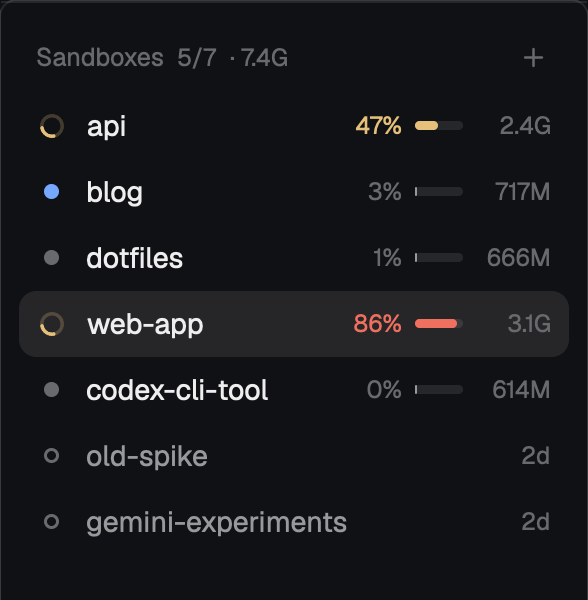
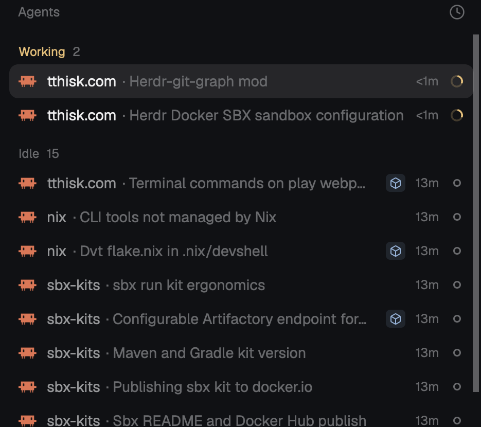

# herdr-sbx

[Herdr](https://herdr.dev) mods for [Docker Sandboxes](https://docs.docker.com/ai/sandboxes/) (`sbx`).

| Mod | What it does |
|---|---|
| [`sbx`](sbx/RECIPE.md) | A **Sandboxes** sidebar panel: every sandbox with its CPU and memory use. Click one to jump to its session, or start one. Hover for a new session, a shell, or stop. |
| [`sbx-agents`](sbx-agents/RECIPE.md) | Herdr's **Agents** panel with a badge on agents running in a sandbox. Needs `sbx`. |

 

## Install

Copy the mod folders into your Herdr home:

```sh
cp -R sbx/mods/sbx sbx-agents/mods/sbx-agents ~/.config/herdr-app/mods/
```

Herdr's own layouts are replaced on every start, so clone one and add the panels
to the clone:

```sh
herdr-app do layout.clone '{"name":"main","as":"my-main"}'
```

Then, in `~/.config/herdr-app/layouts/my-main.json`:

- add `{ "id": "sandboxes", "type": "block", "size": { "weight": 1 }, "min": 90, "content": { "mod": "sbx" } }`
  to the `children` of `sidebar-lists`;
- change the `agents` block's `"mod": "agents"` to `"mod": "sbx-agents"`.

Run `herdr-app check ~/.config/herdr-app/mods/sbx` (and `sbx-agents`), then
`herdr-app status` to see that no errors are reported.

## What they run

Mods are trusted code. Before installing, know that:

- `sbx` runs `sbx ls --json` every 5 s.
- Every 10 s it runs `sbx exec <name> sh -c '…'` in each **running** sandbox, to
  read `/proc/stat`, `/proc/meminfo` and `df`.
- It runs `hc get` / `hc label` on terminals in a sandbox's folder, labelling
  sandbox sessions `sbx.sandbox=<name>`.
- On request, it runs `sbx stop`, `sbx run` and `sbx env run`.
- Neither mod uses the network, and neither reads files outside Herdr's home.

`sbx-agents` is a clone of Herdr's shipped `agents` mod (version 0.1.16) and
doesn't get its later updates. See its recipe for how to re-apply the change to a
fresh clone.

## Developing

To edit the mods in place, symlink them instead of copying:

```sh
ln -s "$PWD/sbx/mods/sbx" ~/.config/herdr-app/mods/sbx
ln -s "$PWD/sbx-agents/mods/sbx-agents" ~/.config/herdr-app/mods/sbx-agents
```

Herdr writes `gpui-kit.d.ts` and `jsconfig.json` into each mod folder for editor
support. They're ignored by git.
