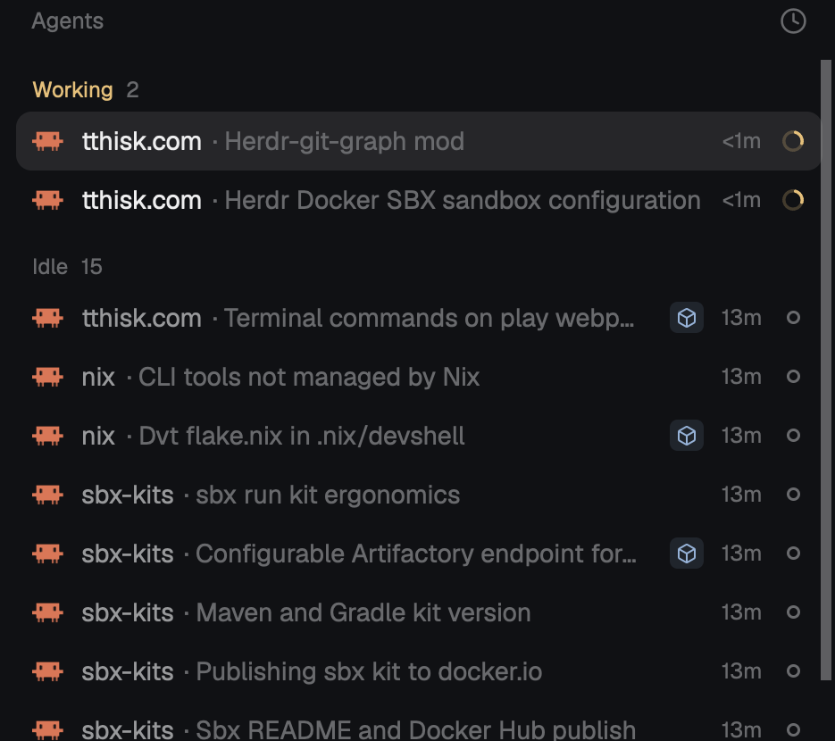

# Sandbox Agents

Herdr's Agents panel, with a badge on every agent that runs inside a Docker
Sandboxes (`sbx`) sandbox. You can tell at a glance which agents are sandboxed and
which run directly on the machine.

Needs the [Sandboxes](../sbx/RECIPE.md) mod (`sbx`), which labels sandbox
terminals. Without it, this panel looks and works exactly like Herdr's own Agents
panel.

## What you see

Everything Herdr's `agents` mod shows (version 0.1.16): priority or space groups,
status marks, durations, pins and sub-agent trees. Added to that:

- **The badge.** An agent whose terminal has the label `sbx.sandbox=<name>` gets
  a badge after its title, before the machine name and the duration:
  - 16px tall, with 4px rounded corners;
  - the `accent` colour at `1f` alpha behind it, and `accent` for its icon and text;
  - an 11px box icon (`box.svg`, a Lucide-style package outline in
    `currentColor`), with 3px side padding.
  - When the sandbox name, minus a leading `claude-`, differs from the agent's
    space name, the badge also shows that short name in 10px medium text, at most
    80px wide and truncated, with 5px side padding.
  - Its tooltip reads `In sandbox <name>`.
- **In the narrow sidebar rail** (`sidebar` narrower than 160px), the agent's
  number is `accent` instead of `muted` when the agent is in a sandbox.

## How it behaves

- **Clicks, keys, sorting and pins** work as in Herdr's Agents panel. The badge
  has no click of its own: clicking it focuses the agent like the rest of the row.
- **Badges come and go with the label.** They appear within a few seconds of the
  Sandboxes panel labelling a terminal, and disappear when the terminal ends.

## Built from

- **Base:** `herdr-app do mod.clone '{"name":"agents","as":"sbx-agents"}'`. The
  clone's own popup (the sort menu) now opens `sbx-agents`.
- **Changes to the clone's `main.js`:**
  - Constants `SANDBOX = "sbx.sandbox"` and `BOX = "mods/sbx-agents/box.svg"`.
  - A `sandboxBadge(t, address, sandbox, spaceName)` builder (an `h_flex` with
    id `sbx-<address>`).
  - In `render`, after `const all = terminals();`, a map from each terminal's
    address to its sandbox:
    `this.sandboxes = new Map(all.filter(x => x.labels?.[SANDBOX]).map(x => [x.address, x.labels[SANDBOX]]))`.
  - In the full row, before the machine name:
    `.when(this.sandboxes.has(a.address), el => el.child(sandboxBadge(...)))`.
  - In the collapsed row, the number's colour switches on `this.sandboxes.has(a.address)`.
- **Files:** `mods/sbx-agents/main.js`, `mod.json` (`"title": "Agents"`,
  `cloned_from`) and `box.svg`.
- **In the layout:** point the agents block at it, e.g. in a clone of `main`:
  `{ "id": "agents", "type": "block", "content": { "mod": "sbx-agents" } }`.
- **Programs and network:** none. It only reads `terminals()` labels.

## Watch out

- **It's a copy of a shipped mod,** so it doesn't get Herdr's later fixes to the
  Agents panel. To update, clone `agents` again and re-apply the changes above.
  They're small and self-contained.
- **Herdr's own layouts can't use it:** they're replaced on every start. Clone the
  layout (`layout.clone`) and change the clone's agents block.
- **The label is the only signal.** An agent in a sandbox that the Sandboxes panel
  hasn't labelled (another machine, a folder that isn't a workspace) gets no badge.
  A terminal that leaves `sbx` keeps its label, and so its badge, until it ends.
- **The icon path names the mod folder.** If you rename the mod, update
  `mods/sbx-agents/box.svg` in `BOX` and the sort menu's `openOverlay({ mod })`.

## Done when

- `herdr-app check mods/sbx-agents` passes, and `herdr-app status` shows no errors.
- Every agent whose terminal has `sbx.sandbox` in `hc get <t>`'s labels shows the
  box badge, and no other agent does.
- Hovering a badge shows `In sandbox <name>`. A sandbox named differently from
  its space also shows its short name in the badge.
- The sort menu (the clock icon) opens and switches between Priority and Grouped.
