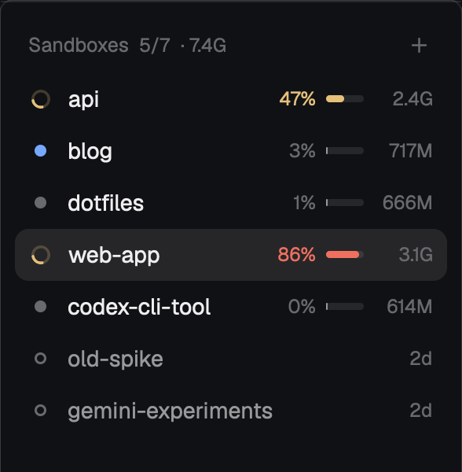

# Sandboxes

A sidebar panel listing every Docker Sandboxes (`sbx`) sandbox on this computer,
with its live CPU and memory use. Clicking a sandbox jumps to its running session,
or starts one in a new tab when it has none.

## What you see

A panel with the sidebar's `chrome` background, a 1px `border` line along its top,
and 13px text. From top to bottom:

- **Header**, 41px tall (14px top padding), 16px side padding:
  - "Sandboxes" in 11.5px medium `dim`.
  - `running/total` in 11px `dim`, e.g. `5/7`.
  - `· 7.4G` in 11px `dim` once readings exist: memory in use summed over the
    running sandboxes. Its tooltip is "Memory in use across running sandboxes".
  - A spacer, then a `+` button (`plus.svg`, 13px) on the right.
- **An error line**, shown only when `sbx ls` fails: 12px `blocked` text reading
  `sbx: <message>`.
- **An empty line**, shown only when there are no sandboxes: 12px `dim` text
  reading "No sandboxes. + starts one in a folder."
- **The list**: a scrolling column with 8px side padding. Each row is 30px tall,
  has 8px padding and 8px rounded corners, and holds:
  - **The status mark:**
    - a 12px `working` spinner that spins once every 900ms while the session's
      agent is working;
    - a 7px `done` or `blocked` dot when the agent has finished or needs you;
    - a 7px `idle` dot when the sandbox is running with no agent status;
    - a 7px ring with a 1.5px `dim` border when the sandbox is stopped.
  - **The name**, with a leading `claude-` removed and truncated to fit:
    `foreground` when running, `muted` when stopped, and `dim` with a line through
    it when the sandbox's workspace folder is missing.
  - **`×N`** in 11px `dim` when the sandbox has more than one session.
  - **On the right**, for a running sandbox: CPU % (a 30px column, right
    aligned), a 22×4px rounded bar showing that share on a `border` track, and
    memory in use (a 34px column, e.g. `2.4G` or `717M`).
    - The CPU number and bar turn `working` at 40% and `blocked` at 80%; below
      that the number is `dim` and the bar `muted`.
    - CPU shows `…` until the second reading.
    - Stopped sandboxes show how long since they were last used instead: `3h`, `2d`.
  - **The row tooltip** says what a click does ("Go to …", "Start a session in …"
    or "Workspace missing: …"). For a running sandbox it adds a line:
    `CPU 47% of 8 vCPU · memory 2.4G / 24G · disk 3.0G / 20G`.
  - A row is `selected` while one of its sessions has focus, and `hover` under
    the pointer.

**The narrow sidebar** (the `sidebar` node narrower than 160px) hides the header
and draws 26px rows with only the centred status mark.

## How it behaves

- **Click a row:**
  - If the sandbox has a session, it focuses that session's pane, preferring
    one with an agent.
  - Otherwise it starts one:
    - `sbx env run <folder>` when the sandbox mounts an `sbxenv.yaml` (it was
      set up from an environment file);
    - else `sbx run --name <name>`.

    Both start a stopped sandbox. The session opens as a new tab named `sbx` in
    the local space already working in that folder (its `folder`, or a tab whose
    pane is in it), or as a new space in the folder.
  - A sandbox whose workspace is missing shows a warning toast instead.
- **Hover a row:** three buttons replace the right-hand numbers:
  - `plus`: a new `sbx` session tab;
  - `terminal`: a tab named `sbx shell` running `sbx exec -it <name> bash`;
  - `square`: stop, running sandboxes only. It runs `sbx stop <name>`, the row
    reads `stopping…` until that returns, and a failure shows an error toast.
- **The header `+`:** opens the system folder picker, then starts a new space in
  that folder running `sbx env run <folder>` when the folder has an
  `sbxenv.yaml`, else `sbx run claude <folder>`.
- **Order:** running sandboxes first, by name; then stopped ones, most recently
  used first. Running ones aren't sorted by last use because every stats reading
  bumps it.
- **What a session is:** a live, local terminal in a pane, labelled
  `sbx.sandbox=<name>`. The panel adds the label itself:
  - It only looks at unlabelled terminals whose folder is a sandbox's workspace,
    asking `hc get` about each one at most every 30s.
  - If the terminal's foreground program is `sbx`, it labels it with the right
    sandbox. When several sandboxes share a folder, it picks the one the command
    names; else one with an `sbxenv.yaml` for `sbx env ...`; else a running one;
    else the most recently used.
  - It matches on the folder of the foreground `sbx` process, not the shell's
    (`cd other && sbx env run` belongs to `other`).
  - Sessions started from the panel and ones started by hand are both found this
    way.

## Built from

- **Files:** `mods/sbx/main.js` and `mods/sbx/mod.json`
  (`{ "place": "none", "title": "Sandboxes" }`). Add it as a block in a layout's
  sidebar, e.g. a third child of `sidebar-lists` in a clone of `main`:
  `{ "id": "sandboxes", "type": "block", "size": { "weight": 1 }, "min": 90, "content": { "mod": "sbx" } }`.
- **Programs it runs:**
  - Every 5s: `sbx ls --json`. It uses `name`, `status`, `last_used_at`,
    `workspaces` and `workspace_missing`. The folder is the first workspace
    without `:ro`.
  - Every 10s, in parallel, for each running sandbox:
    `sbx exec <name> sh -c "head -1 /proc/stat; grep -E '^(MemTotal|MemAvailable):' /proc/meminfo; df -kP / | tail -1; nproc"`.
    - CPU is `1 - Δidle/Δtotal` between two readings, where idle is idle+iowait
      and total is the first 8 fields.
    - Memory used is `MemTotal - MemAvailable`.
  - `hc get <t>` and `hc label <t> sbx.sandbox=<name>` to find and label sessions.
  - `sbx stop <name>`, and `test -f <folder>/sbxenv.yaml` for the `+` button.
- **`herdr` functions:** `exec`, `hc`, `terminals`, `panes`, `spaces`, `run`,
  `theme`, `layout`, `notify`, `pickFolder`, `checking`.
- **Commands:** `pane.focus {pane}`, `tab.new {space, folder, argv, name}`,
  `space.new {folder, argv}`.
- **Icons:** the shipped `mods/workspace-chrome/` icons `plus`, `terminal`,
  `square` and `spinner`.

## Watch out

- **Never run `sbx exec` on a stopped sandbox:** it starts it. Readings are only
  taken for sandboxes `sbx ls` reports as running, and not while one is being
  stopped.
- **Each sandbox is a VM.** Memory is what the guest uses, not the host RAM the
  VM holds. The memory total is the VM's limit (often the host's RAM), which is
  why the bar shows CPU rather than memory: a memory bar would always look empty.
- **Readings bump `last_used_at`,** so running sandboxes always look just used.
- **Stale sessions:** a label stays until the terminal ends. If the person leaves
  `sbx` but keeps the shell, the row still jumps to that shell.
- **Scope:** only local terminals and spaces count (no `machine/` addresses, no
  remote spaces). `sbx` must be on the login shell's PATH. Cloud sandboxes
  (`--cloud`) aren't listed.
- **Load:** with many running sandboxes, every 10s costs one `sbx exec` each
  (about 0.5s apiece, run in parallel).
- **During `herdr-app check`,** `init` returns before starting timers
  (`checking()`).

## Done when

- `herdr-app check mods/sbx` passes, and `herdr-app status` shows no errors.
- The panel lists the same sandboxes as `sbx ls`, with matching running/stopped
  marks.
- About 20s after the panel loads, every running row shows CPU % and memory.
  Running a busy loop in a sandbox
  (`sbx exec <name> sh -c 'timeout 25 sh -c "while :; do :; done"'`, one per
  vCPU) turns its CPU reading red.
- Within 5s, a terminal running `sbx run --name x` (or `sbx env run`) in a
  sandbox's folder has the label `sbx.sandbox=x` (`hc get`). Clicking that row
  focuses it.
- Clicking a sandbox with no session opens a tab named `sbx` running it in the
  matching space.
